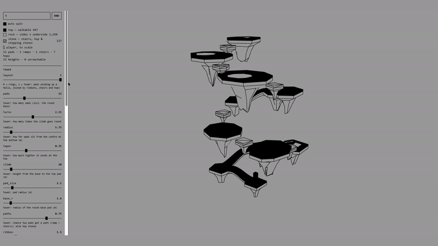

# islandGen



Procedural floating land for 3D platformers. Low-poly pads with flat grass tops and faceted rock
underneath, joined by ramps, stone stairs and hop stones, plus the level data a game needs to play it
(collision, spawn, goal, route, collectible spots, prop spots).

The generator is plain Python and knows nothing about engines. It writes files; a small loader per engine
reads them. A Roblox loader is included in [`roblox/`](roblox/README.md).

## Quick start

```
pip install -r requirements.txt      # numpy, scipy, scikit-image, shapely, mapbox_earcut
python gui/server.py                 # sliders + live 3D view at http://127.0.0.1:8765
```

Move sliders, pick an engine, press **Export**. The GUI only shows the sliders the current layout uses. Output goes to `out/meta_<seed>_<engine>/`.

Or from the command line:

```
python -m islandgen --seed 1 --layout 1 --target roblox             # a tower, for Roblox
python -m islandgen --seed 4 --layout 1 --climb 30 --pads 12 --name my_tower
python -m islandgen --list                                          # every setting, default, range
```

Or from Python:

```python
from islandgen import generate, write_meta
res = generate(1, {"layout": 1, "climb": 25})
write_meta(res, "out/my_tower", target="roblox")
print(res["stats"])        # tris, links (ramp/stairs/hop), unreachable (should be 0)
```

`pip install -e .` also works if you'd rather import it from anywhere.

## Layouts

| `layout` | What you get |
|---|---|
| `1` tower (default) | Pads winding up a helix from a round base pad. Each pad is its own flat layer, so pads can stack over each other. Consecutive pads are joined by a **ramp** (gentle), **stone stairs** (steeper) or **hop stones** (the jumping bits). Dressing spots per pad: sand patch + rocks, lantern, tree, torii on the top pad. |
| `0` rings | Wide floating land: metaballs along broken rings, merged into one top-down field, flat terraces, stepping stones so every piece is reachable. Good for big open areas. |

Both are solved for a player: every step is within `jump`, every gap within `reach`
(`stats.unreachable` reports anything that isn't; it should be 0).

## Units

Everything inside is **meters, Y up, right-handed** (glTF). Exporters convert per engine (`islandgen/units.py`).
Roblox: 1 stud = 0.28 m. The player defaults (`player_height` 1.4, `jump` 2.0, `reach`) match a default
Roblox character; change them if your game changes WalkSpeed / JumpPower / gravity, then regenerate.

## Output files

| File | What |
|---|---|
| `land.glb` | The mesh in meters. Materials: `top`, `rock`, `filler` (stone), `sand`. |
| `land_<engine>.obj` | Same mesh at the engine's scale. For Roblox it's split into chunks under 10k triangles each. |
| `scene.json` | Settings, every metaball, stats. Enough to regenerate or rebuild the land any other way. |
| `level.json` | What a game needs: walk/collision boxes, spawn, goal, route, links, collectible `spots` (with `height01`), `props`, mesh `chunks`. |
| `chunks/*.txt` | Each mesh chunk as compact base64 geometry, so an engine can build the mesh itself (Roblox does, with EditableMesh). |

Collision boxes in `level.json` (`walk.format = "obox"`): `[cx, cy, cz, sx, sy, sz, rx, ry, rz, ux, uy, uz]`,
the centre and size in meters plus the box's right and up vectors.

## Repo layout

```
islandgen/          the generator (engine-agnostic)
  meta.py           settings (PARAMS), rings layout, the shared 2D metaball field, generate()
  tower.py          tower layout: layered pads, ramps / stairs / hops, dressing, level data
  pads.py           the pad mesher: outline -> simplified polygon -> flat cap, lip, faceted rock belly
  level.py          level data for the rings layout (terraces, walk boxes, route, spots) + mesh chunking
  export.py         file writers (glb, obj, json, chunks)
  units.py          engine scales
  legacy/           the first generator (stacked-ring islands, spiral ribbon); unused, kept for reference
gui/                local web GUI (stdlib server + vendored three.js)
roblox/             Roblox loader (Rojo-ready) + an example place
docs/               engine handoff notes
DEVLOG.md           how it got here, decisions and dead ends
```

## Rules this repo keeps

- The generator never imports engine code. Engine code lives in its own folder (`roblox/`).
- Flat walkable tops. Every step jumpable, every piece reachable.
- Meters inside; conversion only at export.
